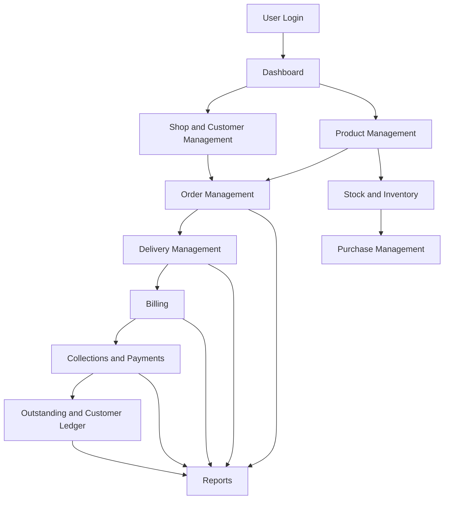
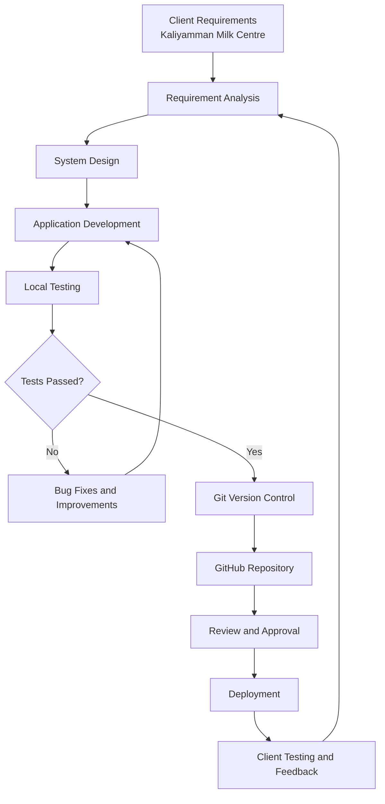

# Milk-distribution-system-documentation

Documentation, workflow, and screenshots for a Flask-based Milk Distribution System.

# Milk Distribution System

### A Web-Based Milk Distribution and Business Management Application

**Client:** Kaliyamman Milk Centre (KMC)  
**Developer:** Sangeetha K  
**Project Status:** Under Development

---

## 📌 Project Description

The Milk Distribution System is a web-based application being developed to streamline and manage the daily operations of a milk distribution business.

The system is designed to support shop and customer management, product management, order processing, delivery management, billing, payment collection, inventory tracking, and business reporting through a centralized application.

The goal is to reduce manual work, improve the accuracy of business records, simplify daily distribution activities, and provide better visibility into customer balances and operational performance.

This application is being developed for **Kaliyamman Milk Centre (KMC)** based on its business workflow and operational requirements.

---

## 🎯 Project Objectives

- Digitize daily milk distribution operations.
- Manage shops, customers, and products.
- Organize customer orders and delivery activities.
- Generate customer bills.
- Record and track payments.
- Monitor outstanding balances and customer ledgers.
- Manage stock and purchase records.
- Provide reports for business monitoring.
- Control staff access according to assigned permissions.

---

## 🛠️ Technology Stack

| Component | Technology |
|---|---|
| Backend | Python |
| Web Framework | Flask |
| Frontend | HTML, CSS, JavaScript |
| Database | MySQL |
| Version Control | Git |
| Source Code Management | GitHub |

---

## 🔄 Application Workflow

---

## 💻 Development Workflow

The application follows an iterative development workflow to support requirement analysis, implementation, testing, and controlled deployment.

---

## 📦 Main Modules

| Module | Purpose |
|---|---|
| Dashboard | View key operational information |
| Shop and Client Management | Maintain shop and customer records |
| Product Management | Manage product information |
| Order Management | Create and manage customer orders |
| Delivery Management | Organize daily deliveries |
| Billing | Generate customer bills |
| Collections and Payments | Record customer payments |
| Outstanding and Ledger | Track balances and financial history |
| Stock and Inventory | Monitor inventory |
| Purchase Management | Maintain purchase records |
| Reports | Review business information |
| Staff Management | Manage staff accounts and permissions |

*Module availability depends on the implemented features and assigned access permissions.*

---

## 📸 Screenshots

Application screenshots will be added as development progresses.

Planned screenshots:

- Dashboard
- Shop and Client Management
- Product Management
- Order Management
- Delivery Management
- Billing and Printed Invoice
- Collections and Outstanding Ledger
- Reports
- Staff Permissions

All screenshots published in this repository will exclude confidential customer information, personal phone numbers, passwords, and sensitive financial records.

---

## 🔐 Security Considerations

- Role-based access control for staff accounts.
- Server-side permission enforcement.
- Secure handling of application credentials.
- Protected database backups.
- Testing before production deployment.

---

## 🚀 Development Status

**Current Stage:** Ongoing Development and Testing

The application is being improved incrementally based on client requirements, testing results, and operational feedback.

Future improvements may include production cloud hosting, enhanced mobile usability, and further workflow automation.

---

## 👩‍💻 Developer

**Sangeetha K**  
M.Sc. Computer Science  
University of Madras

Project developed for **Kaliyamman Milk Centre (KMC)**.

---

## 📄 Disclaimer

This repository documents the development of a client-oriented software project. Public documentation and screenshots must not contain confidential business information, customer data, credentials, or proprietary source code.
